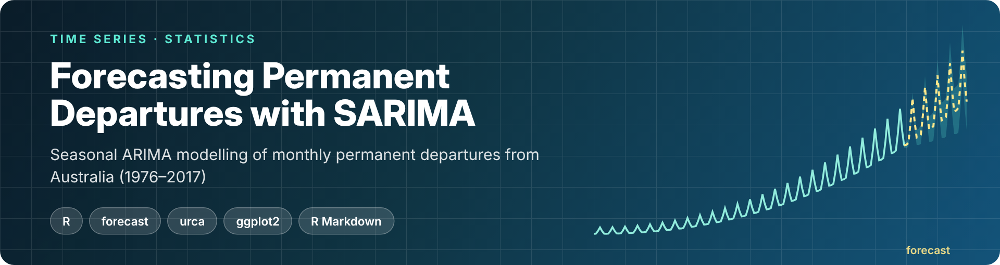
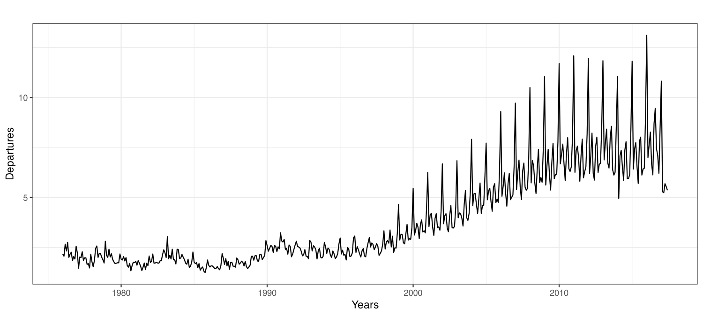
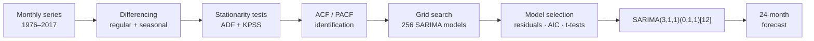
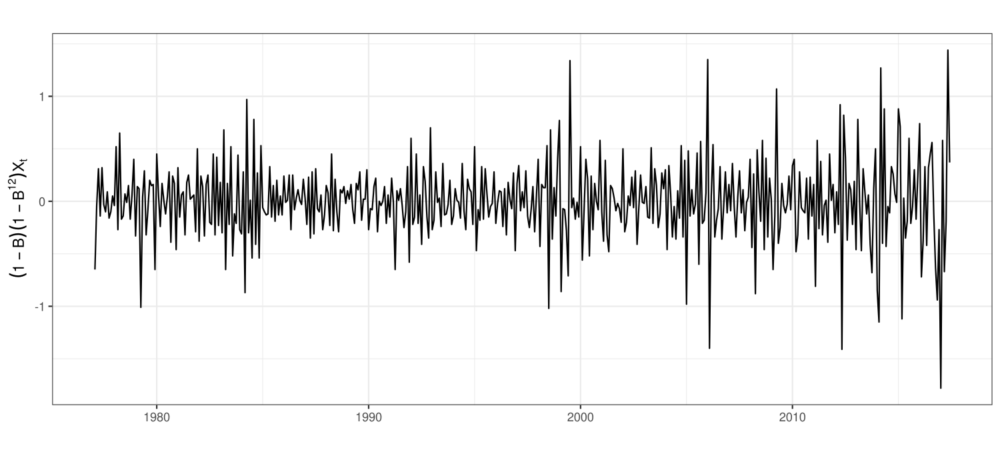
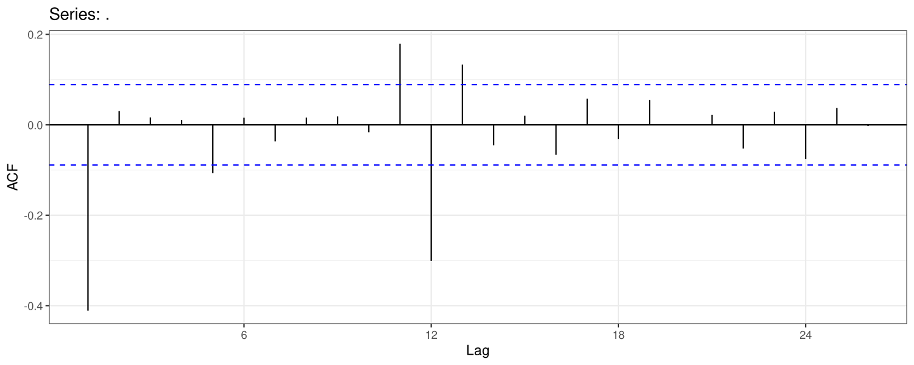
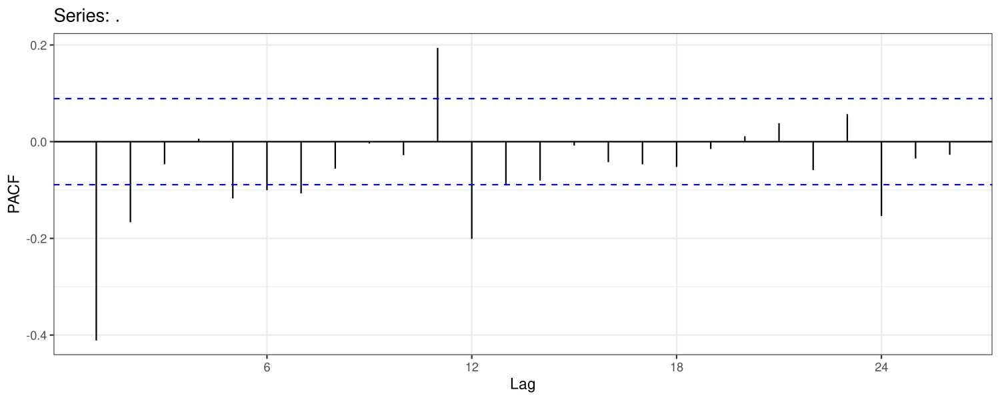
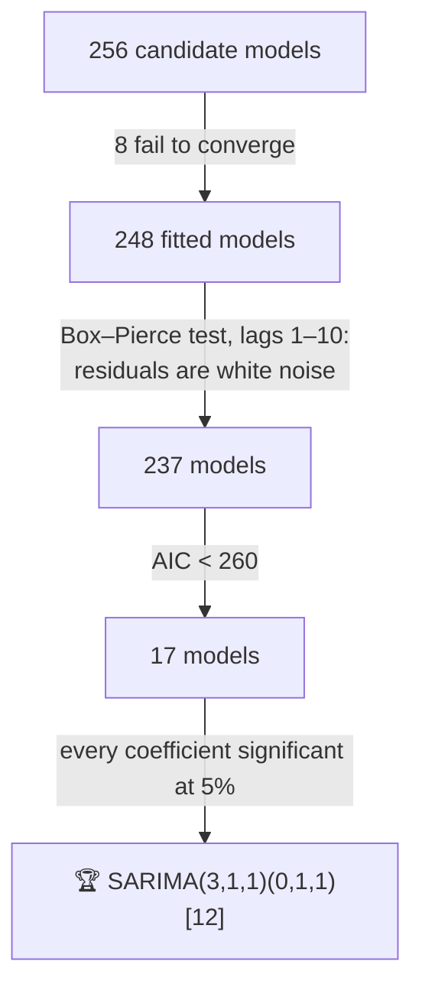

<p align="center">
  
</p>

<p align="center">
  
  
  
  
  
</p>

<p align="center">
  🎓 <b>Academic project</b>, completed during my university studies
</p>

<p align="center">
  <a href="#-overview">Overview</a> •
  <a href="#-data">Data</a> •
  <a href="#-methodology">Methodology</a> •
  <a href="#-analysis">Analysis</a> •
  <a href="#-results">Results</a> •
  <a href="#-how-to-run">How to run</a>
</p>

---

## 📌 Overview

This project models and forecasts the **monthly number of permanent departures from Australia**
using the **Box–Jenkins methodology**.

Instead of trusting `auto.arima()` alone, the analysis runs a **grid search over 256 seasonal ARIMA models**,
then keeps only the ones that pass three statistical filters: white-noise residuals, low AIC, and
significant coefficients. The winner is a compact **SARIMA(3,1,1)(0,1,1)[12]**, which beats
`auto.arima()` by about 10 AIC points.

<div align="center">

| 📅 **498** | 🧪 **256** | ✅ **237** | 🏆 **256.66** |
|:---:|:---:|:---:|:---:|
| monthly observations | candidate models | models with white-noise residuals | AIC of the final model |

</div>

📄 **Full report:** [`reports/departures_report.pdf`](reports/departures_report.pdf)

---

## 📊 Data

| | |
|---|---|
| **Dataset** | `departures` from the [`fpp2`](https://cran.r-project.org/package=fpp2) R package |
| **Series used** | `permanent`: permanent departures from Australia |
| **Period** | January 1976 – June 2017 (monthly, 498 observations) |
| **Source** | Australian Bureau of Statistics, Catalogue No. 3401.02 |

<p align="center">
  
</p>

The series shows a **strong upward trend** after the late 1990s and a **12-month seasonal pattern**
whose size grows over time, so it is clearly **not stationary**.

---

## 🔬 Methodology



---

## 🧪 Analysis

### 1. Making the series stationary

One regular difference and one seasonal difference (lag 12) are applied:

$$
Y_t = (1-B)(1-B^{12})\,X_t
$$

where $B$ is the backshift operator ($B X_t = X_{t-1}$).

<p align="center">
  
</p>

The trend and seasonality are gone and the series moves around zero.

### 2. Stationarity tests

| Test | Null hypothesis | Statistic | Critical value | Decision |
|---|---|:---:|:---:|---|
| **ADF** (no constant, 6 lags) | the series has a unit root | **−11.48** | −2.58 (1%) | ✅ Reject: stationary |
| **KPSS** (level) | the series is stationary | **0.022** | 0.347 (10%) | ✅ Do not reject: stationary |

Both tests agree: the differenced series is **stationary**.

### 3. Identification with ACF and PACF

<table>
  <tr>
    <td width="50%"></td>
    <td width="50%"></td>
  </tr>
  <tr>
    <td align="center"><b>ACF</b>: spikes at lags 1 and 12</td>
    <td align="center"><b>PACF</b>: slower decay (lags 1, 2, 12, 24)</td>
  </tr>
</table>

This points to a non-seasonal **MA(1)** and a seasonal **MA(1)**: the classic "airline" model.
The smaller spikes justify also testing higher AR and MA orders.

### 4. Grid search over 256 models

Every combination of the following orders was fitted, with $d = D = 1$ and period $s = 12$:

- $(p, P)$ and $(q, Q)$ each in $\{(0,0), (1,0), \dots, (13,0), (0,1), (1,1)\}$, giving $16 \times 16 = 256$ models.

The candidates then go through successive filters:



---

## 🏆 Results

### Final model

$$
(1-\phi_1 B-\phi_2 B^2-\phi_3 B^3)(1-B)(1-B^{12})\,X_t=(1+\theta_1 B)(1+\Theta_1 B^{12})\,\varepsilon_t
$$

| Model | Parameters | AIC | Comment |
|---|:---:|:---:|---|
| `auto.arima()`: ARIMA(0,1,1)(0,1,1)[12] | 2 | 266.90 | Benchmark ("airline" model) |
| **SARIMA(3,1,1)(0,1,1)[12]** | **5** | **256.66** | ✅ Selected: white-noise residuals, all coefficients significant |
| ARIMA(8,1,12)(0,1,0)[12] | 20 | 255.66 | Lowest AIC but heavily over-parameterised |

### Forecast

The selected model is fitted on data up to January 2009 and used to forecast the next **24 months**.

<p align="center">
  
</p>

The fitted values follow the observed series closely, and the forecast continues both the trend
and the seasonal peaks, with prediction intervals that widen further into the future.

### 💡 Key takeaways

- A **systematic search** found a better model than `auto.arima()` (AIC 256.66 vs 266.90).
- **AIC alone is not enough**: the lowest-AIC model needs 20 parameters, while the chosen one needs only 5.
- Combining **residual diagnostics + AIC + significance tests** gives a model that is both accurate and simple.

---

## 🚀 How to run

**1. Install the packages** (in R or RStudio):

```r
install.packages(c("fpp2", "forecast", "urca", "latex2exp", "caschrono", "DT", "ggplot2"))
```

**2. Run the analysis:**

```r
source("departures.R")   # use your script's file name
```

> ⏱️ Fitting the 256 models takes several minutes.

**3. (Optional) Rebuild the PDF report:** open `reports/departures_report.Rmd` in RStudio and click **Knit**.
PDF output needs LaTeX; install it once with `tinytex::install_tinytex()`.

---

## 📁 Project structure

```
├── departures.R                 # analysis script
├── reports/
│   ├── departures_report.Rmd    # R Markdown source of the report
│   ├── departures_report.pdf    # full report with interpretation
│   └── departures_report.html   # HTML report (download and open in a browser)
├── images/                      # figures used in this README
└── README.md
```

---

## 🔁 What I would improve today

- [ ] Measure forecast accuracy (RMSE, MAPE) on the 2009–2017 data that the model never saw.
- [ ] Try a Box-Cox transformation, since the seasonal swings grow over time.
- [ ] Compare with other model families (ETS, TBATS, Prophet).
- [ ] Use the Ljung–Box test, which is more reliable than Box–Pierce on small samples.

---

## 👤 Author

**Sadok Triki**

[](https://www.linkedin.com/in/trikisadok)
[](https://github.com/TrikiSadok)

<p align="center"><sub>If you found this useful, consider giving the repo a ⭐</sub></p>
