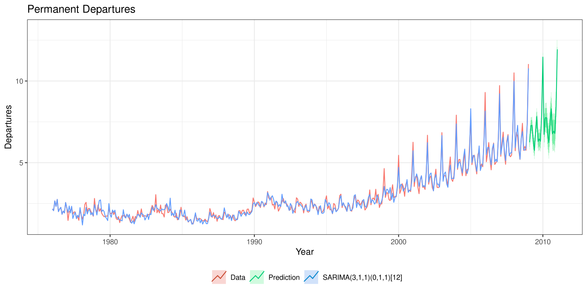

<p align="center">
  
</p>

🎓 *Academic project, completed during my university studies.*

This project forecasts how many people leave Australia permanently each month, using a seasonal ARIMA (SARIMA) model in R. The data covers 1976 to 2017.

<p align="center">
  
</p>

## What I did

- Removed the trend and the yearly seasonality, then confirmed the result with the ADF and KPSS tests.
- Fitted 256 SARIMA models and kept only those with clean residuals, a low AIC and significant coefficients.
- Selected **SARIMA(3,1,1)(0,1,1)[12]** (AIC 256.66), which beats the automatic `auto.arima()` model (AIC 266.90).
- Forecast the next 24 months.

📄 The full report with every step is here: [departures_report.pdf](reports/departures_report.pdf)

## Built with

R · forecast · urca · ggplot2 · R Markdown

## How to run

```r
install.packages(c("fpp2", "forecast", "urca", "latex2exp", "caschrono", "DT", "ggplot2"))
source("departures.R")
```

The data is the `departures` dataset from the `fpp2` package (source: Australian Bureau of Statistics).

## Author

**Sadok Triki** · [LinkedIn](https://www.linkedin.com/in/trikisadok) · [GitHub](https://github.com/TrikiSadok)
